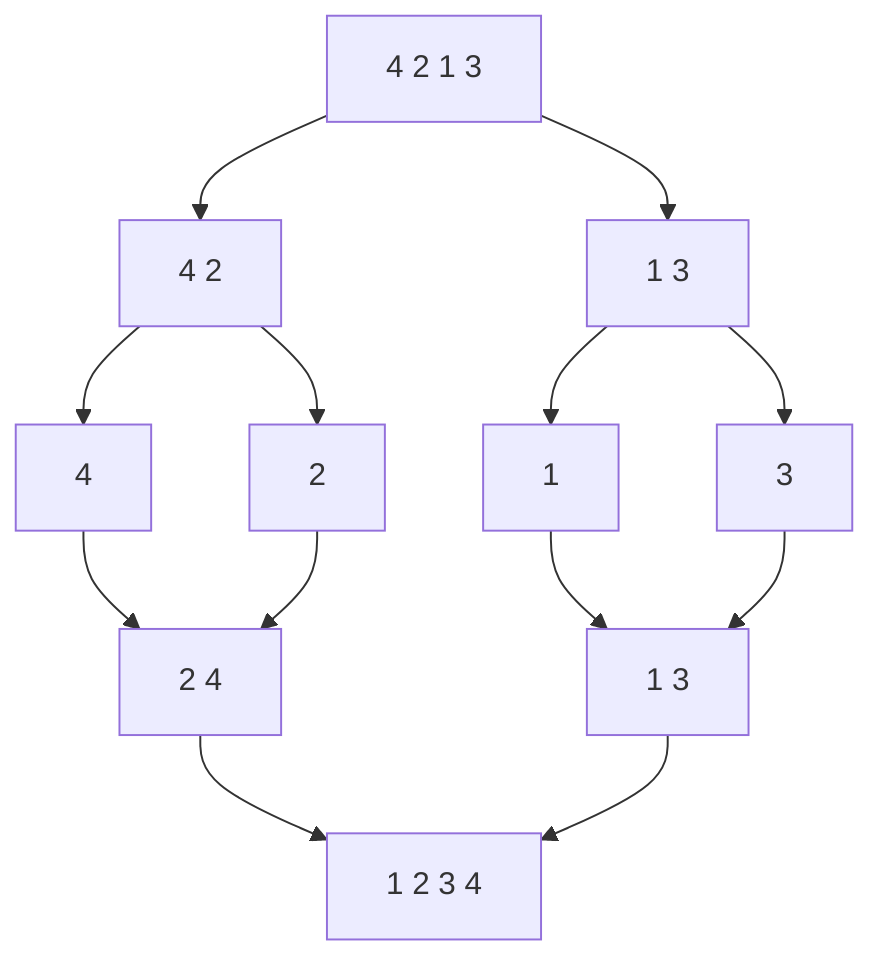

<!-- approaches: Copy, sort, rewrite · Top-down merge sort · Bottom-up merge sort (O(1) space) -->
# 148. Sort List

**Medium** · Linked List · Two Pointers · Divide and Conquer · Sorting · [LeetCode ↗](https://leetcode.com/problems/sort-list/) · Code: [SortList.java](SortList.java) · Tests: [SortListTest.java](SortListTest.java)

## Đề bài

Sắp xếp danh sách liên kết tăng dần. Follow-up: `O(n log n)` thời gian, `O(1)` bộ nhớ.

```
4 → 2 → 1 → 3   =>   1 → 2 → 3 → 4
```

## Ý tưởng

> Danh sách liên kết không truy cập ngẫu nhiên được → Quicksort/Heapsort bất tiện. **Merge sort** chỉ cần duyệt tuần tự và **trộn** hai danh sách (bài 21) — trộn danh sách còn không tốn bộ nhớ phụ như trộn mảng.



## Cách 1 — Chép giá trị, sắp xếp, ghi lại `O(n)` bộ nhớ

Đúng nhưng né mất ý của bài.

## Cách 2 — Merge sort từ trên xuống ⭐

Tìm giữa bằng con trỏ nhanh/chậm (`fast` bắt đầu ở `head.next` để với 2 node thì chia 1 | 1, không lặp vô hạn), cắt đôi, sắp xếp từng nửa, trộn. Stack đệ quy `O(log n)`.

## Cách 3 — Merge sort từ dưới lên `O(1)` bộ nhớ

Không đệ quy: lần lượt trộn các đoạn dài 1, 2, 4, 8… qua từng lượt.

| lượt (size) | danh sách |
|---|---|
| 1 | [4 2] [1 3] → 2 4 1 3 |
| 2 | [2 4 1 3] → 1 2 3 4 |

Hàm `split(head, n)` cắt sau `n` node và trả về phần còn lại.

## Bài liên quan

21 Merge Two Sorted Lists · 23 Merge k Sorted Lists (Hard) · 147 Insertion Sort List · 876 Middle of the Linked List.
