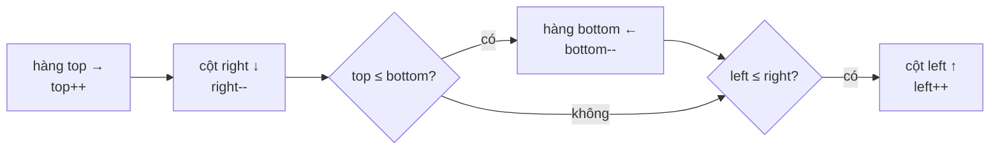

<!-- approaches: Shrinking boundaries · Direction vectors with visited marks -->
# 54. Spiral Matrix

**Medium** · Array · Matrix · Simulation · [LeetCode ↗](https://leetcode.com/problems/spiral-matrix/) · Code: [SpiralMatrix.java](SpiralMatrix.java) · Tests: [SpiralMatrixTest.java](SpiralMatrixTest.java)

## Đề bài

Đọc ma trận `m × n` theo hình **xoắn ốc** thuận chiều kim đồng hồ.

```
1  2  3  4
5  6  7  8      -> 1 2 3 4 8 12 11 10 9 5 6 7
9 10 11 12
```

## Ý tưởng

> Như 59 Spiral Matrix II, nhưng **đọc** thay vì **ghi**, và ma trận có thể **không vuông**. Bốn bức tường co dần vào trong.



## Cách 1 — Bốn bức tường ⭐

**Bẫy:** với ma trận chữ nhật, vòng trong cùng có thể chỉ còn **một hàng** hoặc **một cột**. Sau khi đọc hàng trên và cột phải, phải kiểm tra lại `top ≤ bottom` và `left ≤ right` trước khi đọc hàng dưới / cột trái — nếu không sẽ đọc **trùng**.

| ma trận 3×4 | vòng | đọc |
|---|---|---|
| ngoài | 1 2 3 4 · 8 12 · 11 10 9 · 5 | 10 phần tử |
| trong | 6 7 (chỉ một hàng) | dừng sau hàng trên |

## Cách 2 — Vector hướng + đánh dấu

Đi thẳng, gặp biên hoặc ô đã đi thì rẽ phải. Ít điều kiện biên, tốn thêm mảng đánh dấu.

## Bài liên quan

59 Spiral Matrix II · 885 Spiral Matrix III · 48 Rotate Image.
