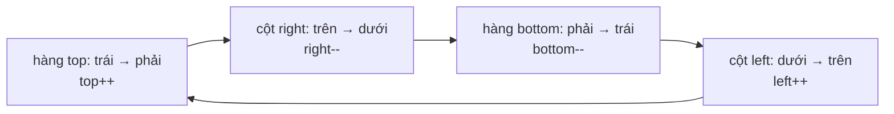

<!-- approaches: Shrinking boundaries · Direction vectors -->
# 59. Spiral Matrix II

**Medium** · Array · Matrix · Simulation · [LeetCode ↗](https://leetcode.com/problems/spiral-matrix-ii/) · Code: [SpiralMatrixII.java](SpiralMatrixII.java) · Tests: [SpiralMatrixIITest.java](SpiralMatrixIITest.java)

## Đề bài

Tạo ma trận `n × n` chứa `1 … n²` theo hình **xoắn ốc** thuận chiều kim đồng hồ.

```
n = 3:   1 2 3
         8 9 4
         7 6 5
```

## Ý tưởng

> Giữ **bốn bức tường** `top, bottom, left, right`. Đi hết một cạnh thì **dời bức tường đó vào trong** một bước. Lặp tới khi các tường gặp nhau.



`n = 4`:

| vòng | đi | giá trị |
|---|---|---|
| ngoài | hàng 0 → cột 3 → hàng 3 → cột 0 | 1–12 |
| trong | hàng 1 → cột 2 → hàng 2 → cột 1 | 13–16 |

## Cách 1 — Bốn bức tường ⭐

Kiểm tra lại `top <= bottom` / `left <= right` trước hai cạnh cuối của mỗi vòng — cần cho ma trận **chữ nhật** (bài 54) và vòng trong cùng chỉ có một hàng/cột.

## Cách 2 — Vector hướng

Đi theo hướng hiện tại; ô kế tiếp ra ngoài hoặc đã điền thì **rẽ phải** (`d = (d + 1) % 4`). Ít điều kiện biên hơn, dùng lại được cho 54 (đánh dấu ô đã đi).

## Bài liên quan

54 Spiral Matrix (đọc theo xoắn ốc) · 885 Spiral Matrix III · 2326 Spiral Matrix IV.
