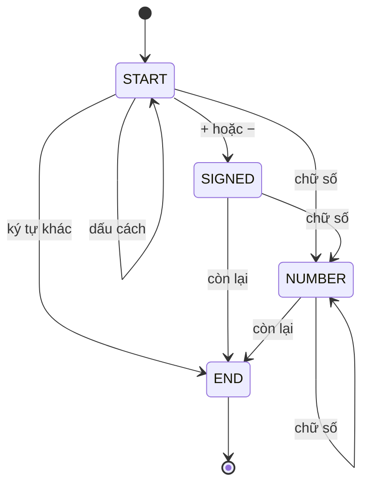

<!-- approaches: Linear scan with overflow guard · State machine -->
# 8. String to Integer (atoi)

**Medium** · String · [LeetCode ↗](https://leetcode.com/problems/string-to-integer-atoi/) · Code: [StringToIntegerAtoi.java](StringToIntegerAtoi.java) · Tests: [StringToIntegerAtoiTest.java](StringToIntegerAtoiTest.java)

## Đề bài

Cài đặt `atoi`: (1) bỏ dấu cách đầu, (2) đọc dấu `+`/`−` (nếu có), (3) đọc chữ số tới khi gặp ký tự khác, (4) kẹp vào khoảng `int`.

```
"   -042" -> -42     "1337c0d3" -> 1337     "words and 987" -> 0     "-91283472332" -> -2147483648
```

## Ý tưởng

> Bài này không khó về thuật toán — nó kiểm tra bạn **đọc kỹ đặc tả** và xử lý **trường hợp biên**. Viết đúng bốn bước, theo thứ tự.



## Cách 1 — Quét tuần tự `O(n)` ⭐

Bốn đoạn code ứng với bốn bước. Chặn tràn **trước** khi nhân:
`result > (MAX − digit) / 10` ⇔ `result·10 + digit > MAX`. Tràn thì trả `MAX` hoặc `MIN` tuỳ dấu.

| chuỗi | sau bỏ cách | dấu | chữ số đọc được | kết quả |
|---|---|---|---|---|
| `"   -042"` | `-042` | − | 042 | −42 |
| `"0-1"` | `0-1` | + | 0 | 0 |
| `"+-12"` | `+-12` | + | (không có) | 0 |

## Cách 2 — Máy trạng thái (DFA) `O(n)`

Bảng `next[state][loại ký tự]` mã hoá toàn bộ luật. Dài hơn, nhưng thêm luật mới (ví dụ cho phép `_` phân cách) chỉ là sửa bảng. Kể được cách này là điểm cộng.

## Bẫy & lưu ý

- Chỉ bỏ dấu cách **ở đầu**; `"+12 34"` → 12.
- Chỉ một dấu: `"+-12"` → 0.
- Số `0` đứng đầu hợp lệ: `"-042"` → −42.
- `−2147483648` hợp lệ: chặn tràn bằng `MAX` rồi nhân dấu sẽ ra `MIN` đúng nhờ nhánh tràn.

## Bài liên quan

7 Reverse Integer · 65 Valid Number (Hard, DFA) · 227 Basic Calculator II.
