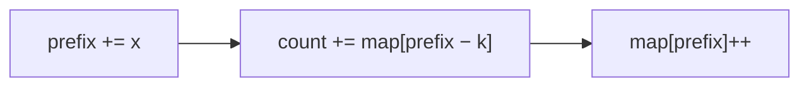

<!-- approaches: Prefix sum + hash map of counts · Brute force O(n^2) -->
# 560. Subarray Sum Equals K

**Medium** · Array · Hash Table · Prefix Sum · [LeetCode ↗](https://leetcode.com/problems/subarray-sum-equals-k/) · Code: [SubarraySumEqualsK.java](SubarraySumEqualsK.java) · Tests: [SubarraySumEqualsKTest.java](SubarraySumEqualsKTest.java)

## Đề bài

Đếm số đoạn con liên tiếp có tổng **đúng bằng `k`**. Phần tử có thể **âm**.

```
[1,2,3], k = 3 -> 2    ([1,2] và [3])
```

## Ý tưởng — prefix sum + HashMap

> `tổng(i..j) = P[j+1] − P[i]`. Đoạn kết thúc tại `j` có tổng `k` ⇔ có một prefix **trước đó** bằng `P[j+1] − k`.
> Đi một lượt, giữ HashMap "**mỗi giá trị prefix đã xuất hiện bao nhiêu lần**", cộng dồn số lần gặp `prefix − k`.

`[1,2,3], k = 3` (map khởi đầu `{0: 1}` — prefix rỗng):

| x | prefix | tìm prefix − k | cộng | map sau |
|---|---|---|---|---|
| 1 | 1 | −2 | 0 | {0:1, 1:1} |
| 2 | 3 | 0 | **1** | {0:1, 1:1, 3:1} |
| 3 | 6 | 3 | **1** | … |



## Cách 1 — Prefix sum + HashMap `O(n)` ⭐

Thứ tự quan trọng: **tra trước, thêm sau** — nếu không, với `k = 0` sẽ đếm cả đoạn rỗng.

**Vì sao không dùng cửa sổ trượt?** Có số âm → mở rộng cửa sổ không làm tổng tăng đơn điệu, cửa sổ trượt không áp dụng được.

## Cách 2 — Vét cạn `O(n²)`

## Bài liên quan

1 Two Sum (cùng ý tưởng "tra phần bù") · 974 Subarray Sums Divisible by K · 525 Contiguous Array · 437 Path Sum III · 1074 Number of Submatrices That Sum to Target.
