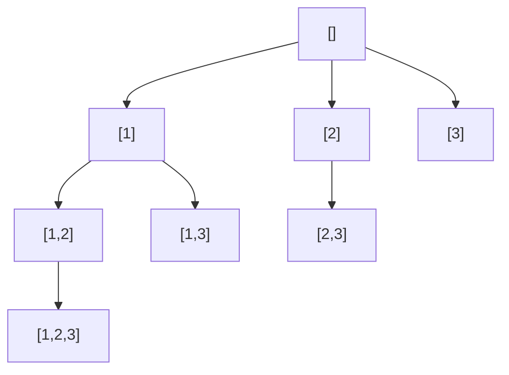

<!-- approaches: Backtracking · Iterative doubling · Bitmask -->
# 78. Subsets

**Medium** · Array · Backtracking · Bit Manipulation · [LeetCode ↗](https://leetcode.com/problems/subsets/) · Code: [Subsets.java](Subsets.java) · Tests: [SubsetsTest.java](SubsetsTest.java)

## Đề bài

Liệt kê **mọi tập con** của một mảng các số khác nhau.

```
[1,2,3] -> [], [1], [2], [3], [1,2], [1,3], [2,3], [1,2,3]     (2³ = 8 tập)
```

## Ý tưởng

> Mỗi phần tử có đúng hai lựa chọn: **lấy** hoặc **không lấy** → `2ⁿ` tập con. Ba cách liệt kê tương ứng ba góc nhìn về cùng một cây quyết định.



## Cách 1 — Backtracking ⭐

**Mỗi node** của cây là một tập con (không chỉ lá). Từ một tập, chỉ thêm phần tử có chỉ số **lớn hơn** phần tử cuối (`start`) để không sinh `[2,1]` sau khi đã có `[1,2]`.

```
backtrack(start):
    lưu bản sao path
    for i in start..n−1:
        path.add(nums[i]); backtrack(i + 1); path.removeLast()
```

## Cách 2 — Nhân đôi dần

| sau khi xét | các tập con |
|---|---|
| (đầu) | [] |
| 1 | [] [1] |
| 2 | [] [1] [2] [1,2] |
| 3 | … thêm [3] [1,3] [2,3] [1,2,3] |

## Cách 3 — Bitmask

Số `mask` từ `0` tới `2ⁿ − 1`: bit `i` bằng 1 ⇔ lấy `nums[i]`. `mask = 5 = 101₂` → `[nums[0], nums[2]]`.

## Độ phức tạp

`O(n · 2ⁿ)` thời gian (có `2ⁿ` tập, mỗi tập sao chép tối đa `n` phần tử) — không thể tốt hơn vì phải in ra hết.

## Bẫy & lưu ý

- `out.add(path)` mà không sao chép → mọi phần tử của `out` cùng trỏ vào một list, cuối cùng đều rỗng.

## Bài liên quan

90 Subsets II (có phần tử trùng) · 46 Permutations · 77 Combinations · 39 Combination Sum.
