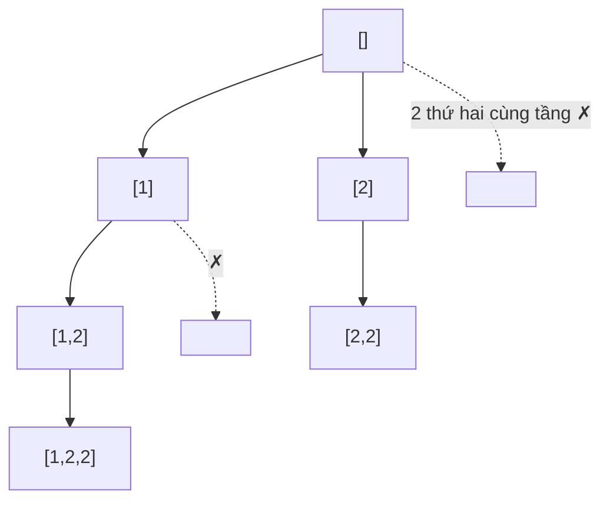

<!-- approaches: Backtracking with skip rule · Iterative extending the last batch -->
# 90. Subsets II

**Medium** · Array · Backtracking · Bit Manipulation · [LeetCode ↗](https://leetcode.com/problems/subsets-ii/) · Code: [SubsetsII.java](SubsetsII.java) · Tests: [SubsetsIITest.java](SubsetsIITest.java)

## Đề bài

Liệt kê mọi tập con **không trùng** của một mảng **có phần tử lặp**.

```
[1,2,2] -> [], [1], [1,2], [1,2,2], [2], [2,2]      (không có hai lần [1,2])
```

## Ý tưởng

> Sắp xếp để các giá trị giống nhau đứng cạnh nhau. Ở **cùng một tầng** của cây backtracking, chỉ thử mỗi giá trị **một lần** — lần thử thứ hai sẽ sinh lại đúng các tập con như lần đầu.



## Cách 1 — Backtracking + bỏ qua cùng tầng ⭐

Điều kiện `i > start && a[i] == a[i−1]`: **khác** với 47 Permutations II (`!used[i−1]`), vì ở đây ta đi theo chỉ số tăng dần nên "cùng tầng" ⇔ `i > start`.

## Cách 2 — Lặp: giá trị lặp chỉ mở rộng lô vừa tạo

Như Subsets (nhân đôi), nhưng nếu `a[i]` bằng `a[i−1]` thì chỉ thêm `a[i]` vào các tập con **mới sinh ở bước trước** (đã chứa `a[i−1]`); thêm vào các tập cũ sẽ tạo trùng.

| xét | các tập con |
|---|---|
| 1 | [] [1] |
| 2 | … [2] [1,2] |
| 2 (lặp) | chỉ mở rộng [2], [1,2] → [2,2] [1,2,2] |

## Bài liên quan

78 Subsets · 47 Permutations II · 40 Combination Sum II.
