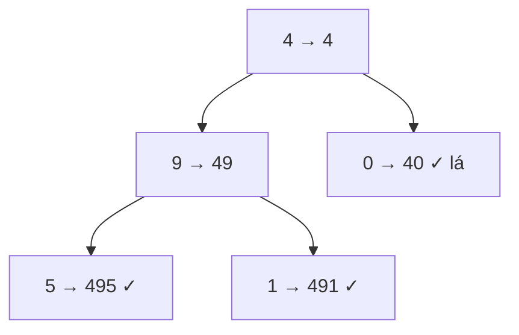

<!-- approaches: DFS passing the number · Iterative BFS -->
# 129. Sum Root to Leaf Numbers

**Medium** · Tree · Depth-First Search · Binary Tree · [LeetCode ↗](https://leetcode.com/problems/sum-root-to-leaf-numbers/) · Code: [SumRootToLeafNumbers.java](SumRootToLeafNumbers.java) · Tests: [SumRootToLeafNumbersTest.java](SumRootToLeafNumbersTest.java)

## Đề bài

Mỗi đường từ gốc tới lá tạo thành một số (`1 → 2 → 3` là `123`). Tính tổng các số đó.

```
    4
   / \
  9   0        -> 495 + 491 + 40 = 1026
 / \
5   1
```

## Ý tưởng

> Đi xuống thì **nối thêm chữ số** vào cuối: `số mới = số cũ · 10 + val` (giống đọc số thập phân từ trái sang). Tới lá thì số đã hoàn chỉnh.



## Cách 1 — DFS truyền số hiện tại ⭐

Giá trị truyền theo tham số (kiểu `int`) nên tự "hoàn tác" khi quay lui — không cần backtracking thủ công.

## Cách 2 — BFS với cặp (node, số)

## Bài liên quan

112 Path Sum · 257 Binary Tree Paths · 1022 Sum of Root To Leaf Binary Numbers (như bài này nhưng cơ số 2).
