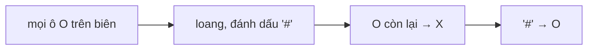

<!-- approaches: Flood fill from the border, then flip -->
# 130. Surrounded Regions

**Medium** · Array · Depth-First Search · Breadth-First Search · Union-Find · [LeetCode ↗](https://leetcode.com/problems/surrounded-regions/) · Code: [SurroundedRegions.java](SurroundedRegions.java) · Tests: [SurroundedRegionsTest.java](SurroundedRegionsTest.java)

## Đề bài

Lật thành `X` mọi vùng `O` bị `X` **bao kín** — tức là vùng `O` không chạm biên.

```
X X X X        X X X X
X O O X   ->   X X X X
X X O X        X X X X
X O X X        X O X X    (O ở biên không bị bao)
```

## Ý tưởng — nghĩ ngược

> Tìm vùng "bị bao" khó; tìm vùng **"an toàn"** dễ hơn: một `O` an toàn ⇔ **nối được ra biên**.
> Loang (flood fill) từ mọi `O` trên biên, đánh dấu `#`. Cuối cùng: `O` còn lại → `X`, `#` → `O`.



## Lời giải `O(m·n)` ⭐

Dùng **stack tường minh** thay cho đệ quy: lưới 300×300 toàn `O` tạo một vùng 90 000 ô — DFS đệ quy dễ tràn stack (test có ca này).

## Bài liên quan

200 Number of Islands · 417 Pacific Atlantic Water Flow · 1020 Number of Enclaves · 1254 Number of Closed Islands.
