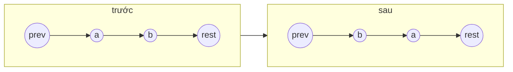

<!-- approaches: Iterative with dummy · Recursive -->
# 24. Swap Nodes in Pairs

**Medium** · Linked List · Recursion · [LeetCode ↗](https://leetcode.com/problems/swap-nodes-in-pairs/) · Code: [SwapNodesInPairs.java](SwapNodesInPairs.java) · Tests: [SwapNodesInPairsTest.java](SwapNodesInPairsTest.java)

## Đề bài

Đổi chỗ **từng cặp node liền kề** (đổi node, không đổi giá trị).

```
1 → 2 → 3 → 4   =>   2 → 1 → 4 → 3
```

## Ý tưởng

> Mỗi lần xử lý cặp `a, b` đứng sau `prev`: ba con trỏ cần sửa.
> `prev → a → b → rest` thành `prev → b → a → rest`, rồi `prev` nhảy tới `a` (giờ là cuối cặp).



Thứ tự gán (không được đổi): `a.next = b.next` → `b.next = a` → `prev.next = b`.

## Cách 1 — Lặp với node giả ⭐

Node giả `dummy` giúp cặp đầu tiên không phải xử lý riêng (đầu danh sách thay đổi).

## Cách 2 — Đệ quy

Đổi hai node đầu, nối `head.next` với kết quả đổi phần còn lại.

## Bài liên quan

25 Reverse Nodes in k-Group (Hard, tổng quát với k) · 206 Reverse Linked List · 1721 Swapping Nodes in a Linked List.
