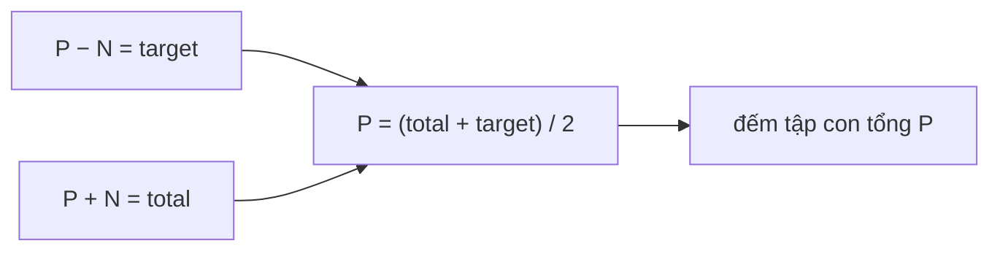

<!-- approaches: Subset-sum DP (count) · Memoized DFS -->
# 494. Target Sum

**Medium** · Array · Dynamic Programming · Backtracking · Knapsack Problem · [LeetCode ↗](https://leetcode.com/problems/target-sum/) · Code: [TargetSum.java](TargetSum.java) · Tests: [TargetSumTest.java](TargetSumTest.java)

## Đề bài

Đặt `+` hoặc `−` trước mỗi số trong `nums`. Có bao nhiêu cách để biểu thức bằng `target`?

```
[1,1,1,1,1], target = 3 -> 5     (−1+1+1+1+1, +1−1+1+1+1, …)
```

## Ý tưởng — đưa về bài đếm tập con

> Gọi `P` = tổng các số mang dấu `+`, `N` = tổng các số mang dấu `−`.
> `P − N = target` và `P + N = total` ⇒ **`P = (total + target) / 2`**.
> Bài toán thành: **đếm số tập con có tổng bằng `P`** — knapsack 0/1.



`ways[s]` = số cách chọn được tổng `s`. Với mỗi số `x`: `ways[s] += ways[s − x]`, duyệt `s` **giảm dần** để mỗi số chỉ dùng một lần.

| sau số | ways[0..4] (P = 4) |
|---|---|
| — | 1 0 0 0 0 |
| 1 | 1 1 0 0 0 |
| 1 | 1 2 1 0 0 |
| 1 | 1 3 3 1 0 |
| 1 | 1 4 6 4 1 |
| 1 | 1 5 10 10 **5** |

## Cách 1 — DP đếm tập con `O(n·P)` ⭐

**Bẫy:** `total + target` lẻ hoặc `|target| > total` → 0 cách. Số `0` nhân đôi số cách (`+0` và `−0`) — DP xử lý đúng tự nhiên.

## Cách 2 — DFS + memo

Trạng thái `(chỉ số, phần còn lại)`. Dễ nghĩ ra hơn, nhưng chậm hơn.

## Bài liên quan

416 Partition Equal Subset Sum · 1049 Last Stone Weight II · 518 Coin Change II.
