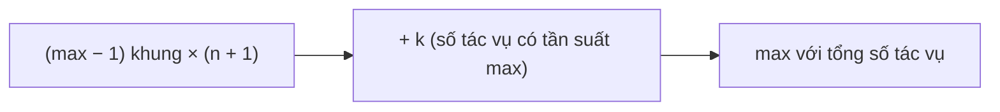

<!-- approaches: Simulation with a max-heap · Counting formula -->
# 621. Task Scheduler

**Medium** · Array · Hash Table · Greedy · Sorting · [LeetCode ↗](https://leetcode.com/problems/task-scheduler/) · Code: [TaskScheduler.java](TaskScheduler.java) · Tests: [TaskSchedulerTest.java](TaskSchedulerTest.java)

## Đề bài

Các tác vụ là chữ cái, mỗi tác vụ chạy 1 đơn vị thời gian. Hai lần chạy **cùng loại** phải cách nhau ít nhất `n` đơn vị (được phép nghỉ). Thời gian ít nhất để chạy hết?

```
[A,A,A,B,B,B], n = 2 -> 8     A B _ A B _ A B
```

## Ý tưởng

> Tác vụ **xuất hiện nhiều nhất** quyết định khung thời gian. Nếu `A` xuất hiện `max` lần thì cần `max − 1` "khung" dài `n + 1`, cộng với khung cuối chứa các tác vụ có cùng tần suất `max`.

```
 max = 3 (A), n = 2:     [A ? ?] [A ? ?] [A]
 B cũng 3 lần (k = 2):   [A B _] [A B _] [A B]   -> (3−1)·3 + 2 = 8
```



Nếu các tác vụ khác **nhiều hơn** chỗ trống, chúng lấp đầy và còn tràn ra → không cần nghỉ lần nào → đáp án là tổng số tác vụ. Vì vậy lấy `max(tasks.length, công thức)`.

## Cách 1 — Mô phỏng bằng max-heap

Mỗi đơn vị thời gian, chạy tác vụ **còn nhiều nhất** trong số đã hết thời gian chờ; tác vụ vừa chạy vào hàng đợi "nguội" tới thời điểm `time + n`. Dùng làm chuẩn để test, và cách này mở rộng được nếu đề yêu cầu in ra lịch chạy.

## Cách 2 — Công thức đếm `O(N)` ⭐

## Bài liên quan

358 Rearrange String k Distance Apart · 767 Reorganize String · 2365 Task Scheduler II.
