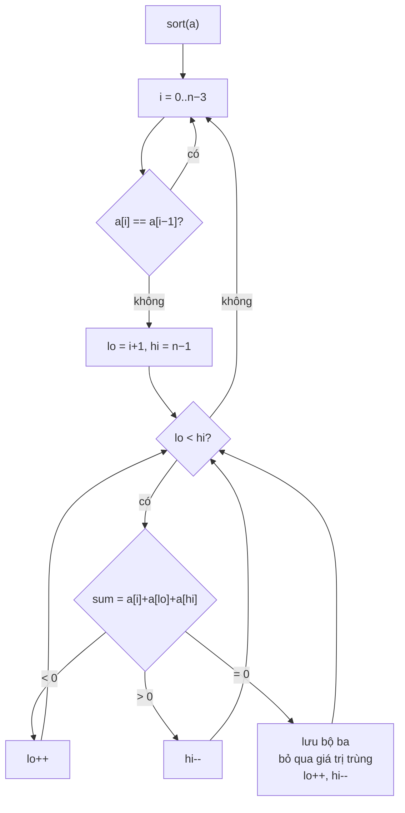

<!-- approaches: Brute force · Sort + hash set · Sort + two pointers -->
# 15. 3Sum

**Medium** · Array · Two Pointers · Sorting · [LeetCode ↗](https://leetcode.com/problems/3sum/) · Code: [ThreeSum.java](ThreeSum.java) · Tests: [ThreeSumTest.java](ThreeSumTest.java)

## Đề bài

Tìm mọi bộ ba **không trùng nhau** có tổng bằng `0`.

```
[-1,0,1,2,-1,-4] -> [[-1,-1,2], [-1,0,1]]
```

## Ý tưởng

> **Cố định** phần tử nhỏ nhất `a[i]`, bài còn lại là **Two Sum** tìm hai số có tổng `−a[i]` trên đoạn bên phải.
> **Sắp xếp** trước giúp hai việc: dùng được hai con trỏ, và các giá trị trùng nằm liền nhau nên **bỏ qua** dễ dàng.

## Cách 1 — Vét cạn `O(n³)`

Ba vòng lặp + `Set` để khử trùng. Chỉ dùng làm chuẩn để test.

## Cách 2 — Sắp xếp + HashSet `O(n²) · O(n)`

Cố định `i`, chạy Two Sum bằng HashSet trên `a[i+1..]`.

## Cách 3 — Sắp xếp + hai con trỏ `O(n²) · O(1)` ⭐



`[-4, -1, -1, 0, 1, 2]`, `i = 1` (`a[i] = −1`, cần tổng hai số = 1):

| lo | hi | a[lo] | a[hi] | sum | hành động |
|---|---|---|---|---|---|
| 2 | 5 | −1 | 2 | 0 | lưu `[-1,-1,2]`, lo=3, hi=4 |
| 3 | 4 | 0 | 1 | 0 | lưu `[-1,0,1]` |

`i = 2` có `a[2] == a[1]` → bỏ qua (nếu không sẽ ra lại `[-1,0,1]`).

## Ba chỗ khử trùng

1. `a[i] == a[i−1]` → bỏ qua `i`.
2. Sau khi tìm thấy, bỏ qua mọi `a[lo]` trùng.
3. …và mọi `a[hi]` trùng.

Tối ưu thêm: `a[i] > 0` → `break` (ba số dương không thể có tổng 0).

## Bài liên quan

1 Two Sum · 167 Two Sum II · 16 3Sum Closest · 18 4Sum · 259 3Sum Smaller.
