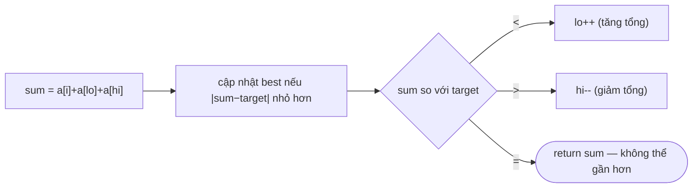

<!-- approaches: Brute force · Sort + two pointers -->
# 16. 3Sum Closest

**Medium** · Array · Two Pointers · Sorting · [LeetCode ↗](https://leetcode.com/problems/3sum-closest/) · Code: [ThreeSumClosest.java](ThreeSumClosest.java) · Tests: [ThreeSumClosestTest.java](ThreeSumClosestTest.java)

## Đề bài

Chọn ba số có tổng **gần `target` nhất**, trả về tổng đó.

```
[-1,2,1,-4], target = 1 -> 2   (-1 + 2 + 1)
```

## Ý tưởng

> Cùng khuôn với 3Sum: sắp xếp, cố định `a[i]`, hai con trỏ trên phần còn lại. Khác biệt: ở **mỗi bước**
> cập nhật tổng gần nhất, rồi dịch con trỏ về phía làm tổng **tiến gần** `target`.



## Cách 1 — Vét cạn `O(n³)`

## Cách 2 — Sắp xếp + hai con trỏ `O(n²)` ⭐

`[-4, -1, 1, 2]`, target = 1:

| i | lo | hi | sum | best | hành động |
|---|---|---|---|---|---|
| −4 | −1 | 2 | −3 | −3 | < 1 → lo++ |
| −4 | 1 | 2 | −1 | −1 | lo++ (lo = hi, hết) |
| −1 | 1 | 2 | 2 | **2** | > 1 → hi-- |

Vì sao không bỏ sót? Khi `sum < target`, mọi bộ `(i, lo, hi')` với `hi' < hi` còn nhỏ hơn → xa hơn → bỏ `lo` hiện tại là an toàn (tương tự chiều ngược lại).

## Bẫy & lưu ý

- Khởi tạo `best` bằng một tổng **có thật** (`a[0]+a[1]+a[2]`), không phải `Integer.MAX_VALUE` (dễ tràn khi trừ `target`).
- Bài này không cần khử trùng vì chỉ trả về một số.

## Bài liên quan

15 3Sum · 18 4Sum · 259 3Sum Smaller.
