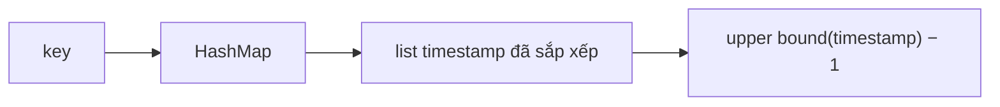

<!-- approaches: HashMap of timestamp lists + binary search · HashMap of TreeMap -->
# 981. Time Based Key-Value Store

**Medium** · Hash Table · String · Binary Search · Design · [LeetCode ↗](https://leetcode.com/problems/time-based-key-value-store/) · Code: [TimeBasedKeyValueStore.java](TimeBasedKeyValueStore.java) · Tests: [TimeBasedKeyValueStoreTest.java](TimeBasedKeyValueStoreTest.java)

## Đề bài

Thiết kế `TimeMap`:
- `set(key, value, timestamp)` — lưu giá trị kèm thời điểm;
- `get(key, timestamp)` — trả giá trị được `set` với thời điểm **lớn nhất ≤ `timestamp`**, không có thì `""`.

Các lần `set` có `timestamp` **tăng dần**.

```
set(foo, bar, 1)  set(foo, bar2, 4)
get(foo, 3) -> bar     get(foo, 5) -> bar2     get(foo, 0) -> ""
```

## Ý tưởng

> Mỗi key giữ danh sách `(timestamp, value)`. Vì `timestamp` tăng dần nên danh sách **tự động đã sắp xếp** → `get` là **tìm nhị phân** phần tử cuối cùng `≤ timestamp`.

```
foo:  t = [1,    4,     9]
      v = [bar,  bar2,  bar3]
get(foo, 5): vị trí đầu tiên có t > 5 là 2 → lấy vị trí 1 → "bar2"
```



## Cách 1 — HashMap + danh sách + tìm nhị phân ⭐

`set` `O(1)`, `get` `O(log n)`.

## Cách 2 — HashMap của TreeMap

`floorEntry(timestamp)` làm đúng việc cần. Đúng cả khi `timestamp` không tăng dần, nhưng tốn bộ nhớ hơn.

## Ứng dụng thực tế

Ý tưởng của **MVCC** trong database (đọc phiên bản tại một thời điểm), **etcd** revision, lịch sử cấu hình.

## Bài liên quan

1146 Snapshot Array · 2034 Stock Price Fluctuation · 362 Design Hit Counter.
