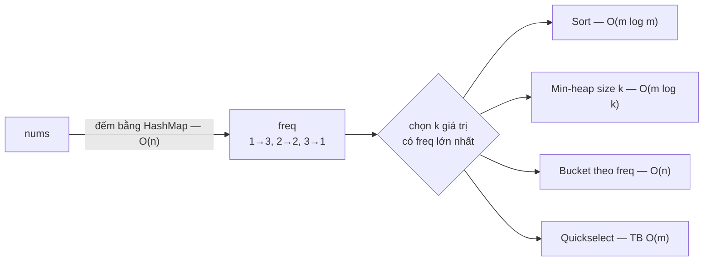
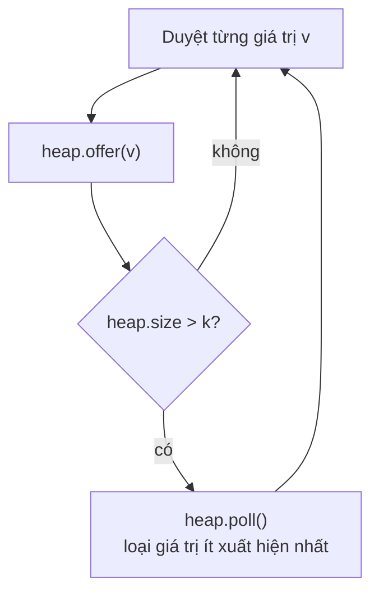
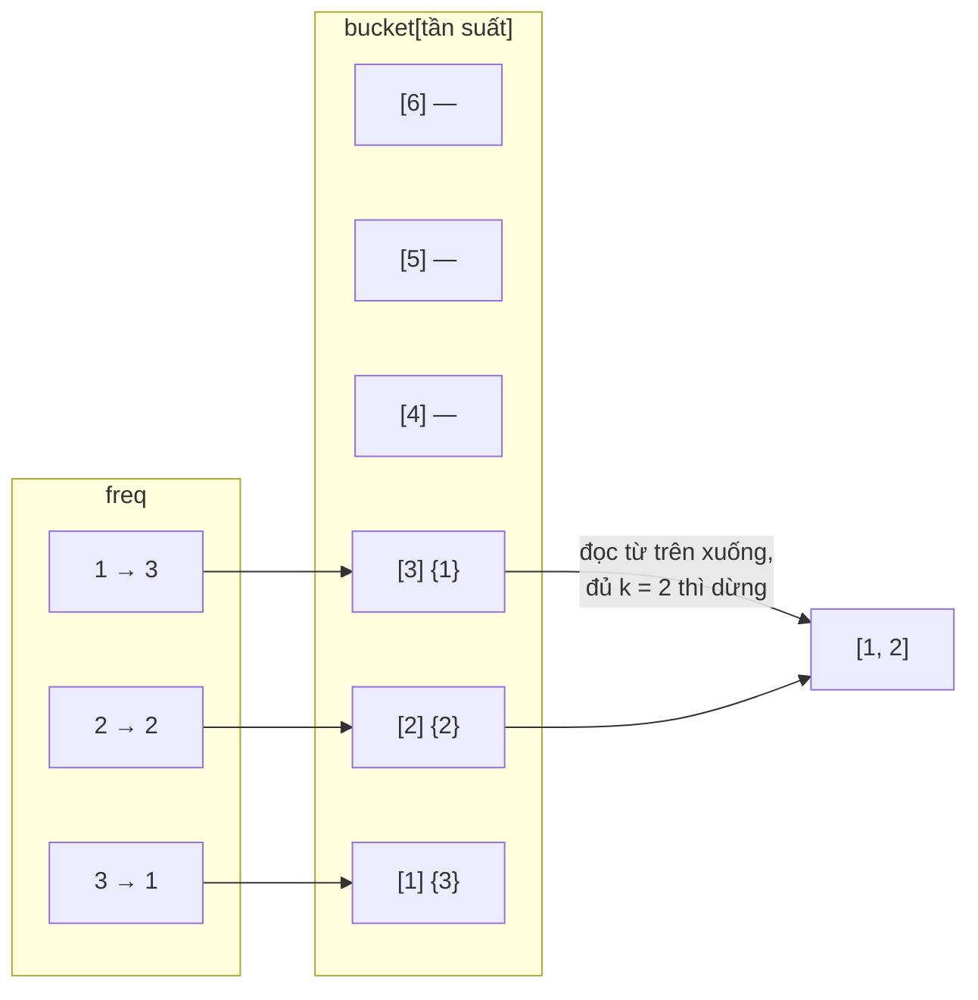
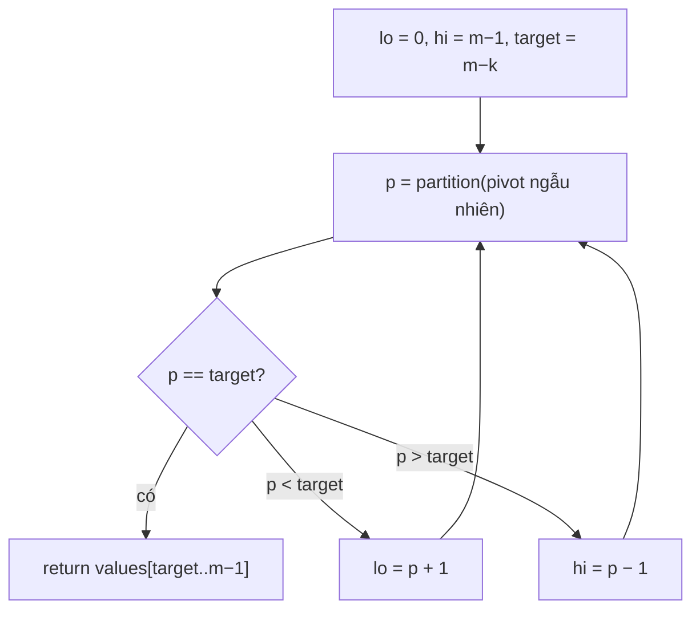

<!-- approaches: Sort · Min-heap · Bucket sort · Quickselect -->
# 347. Top K Frequent Elements — Medium

🔗 https://leetcode.com/problems/top-k-frequent-elements/ · Code: [TopKFrequentElements.java](TopKFrequentElements.java) · Tests: [TopKFrequentElementsTest.java](TopKFrequentElementsTest.java)

## Đề bài

Cho mảng `nums` và số `k`, trả về `k` phần tử **xuất hiện nhiều nhất** (thứ tự tuỳ ý, đáp án là duy nhất).
**Follow-up:** phải nhanh hơn O(n log n).

```
nums = [1,1,1,2,2,3], k = 2  ->  [1, 2]
```

## Ý tưởng cốt lõi

Mọi cách đều gồm **2 bước**:



(`m` = số giá trị phân biệt, `m ≤ n`). Khác nhau chỉ ở bước 2 — đây chính là câu hỏi "chọn top-k" kinh điển.

## Các cách giải

| # | Cách | Thời gian | Bộ nhớ | Khi nào dùng |
|---|---|---|---|---|
| 1 | Sort theo tần suất | O(n + m log m) | O(m) | Code nhanh nhất; không đạt follow-up khi m ≈ n |
| 2 | Min-heap kích thước k | O(n + m log k) | O(m + k) | k nhỏ, hoặc dữ liệu dạng **stream** |
| 3 | Bucket sort | **O(n)** | O(n) | Đạt follow-up, dễ giải thích — **nên trình bày** |
| 4 | Quickselect | TB O(n), xấu nhất O(m²) | O(m) | Muốn O(n) không cần mảng bucket; giống bài 215 |

### Cách 2 — min-heap giữ k "ứng viên"

Heap là **min-heap theo tần suất**: gốc là ứng viên yếu nhất trong top-k hiện tại; khi heap vượt k phần tử thì loại gốc.



> Vì sao **min**-heap chứ không phải max-heap? Max-heap phải chứa cả m phần tử (O(m log m)); min-heap chỉ giữ k → O(m log k).

### Cách 3 — bucket sort (đạt follow-up)

Tần suất của một giá trị nằm trong `[1, n]` → tạo `n + 1` "xô", xô `f` chứa các giá trị xuất hiện đúng `f` lần, rồi đọc từ xô cao nhất xuống.



### Cách 4 — quickselect

Đặt các giá trị phân biệt vào mảng, **partition theo tần suất** (nhỏ bên trái). Khi pivot rơi đúng vị trí `m − k`, phần bên phải chính là top-k (không cần sắp xếp).



Pivot **ngẫu nhiên** để tránh trường hợp xấu O(m²) với dữ liệu đã sắp sẵn.

## Bẫy hay gặp

- Comparator `(a, b) -> freq.get(b) - freq.get(a)` an toàn ở đây vì tần suất ≤ 10⁵ (không tràn số); với giá trị tuỳ ý nên dùng `Integer.compare`.
- Bucket cần kích thước `n + 1` (một giá trị có thể xuất hiện đủ n lần).
- Heap dùng `freq::get` làm khoá — đừng sửa `freq` sau khi đã đưa vào heap.

## Câu hỏi phỏng vấn hay hỏi thêm

1. *Dữ liệu quá lớn, không vừa RAM?* → đếm theo từng phần (hoặc Count-Min Sketch nếu chấp nhận xấp xỉ), rồi gộp và giữ heap k.
2. *Stream liên tục, hỏi top-k bất kỳ lúc nào?* → HashMap đếm + heap k (cập nhật khi tần suất đổi), hoặc thuật toán Misra–Gries / Space-Saving.
3. *Có tie ở vị trí k?* → đề đảm bảo không có; nếu có, cần quy tắc phụ (ví dụ giá trị nhỏ hơn thắng) đưa vào comparator.

Bài liên quan: 215 (Kth Largest), 692 (Top K Frequent Words), 451 (Sort Characters By Frequency).
