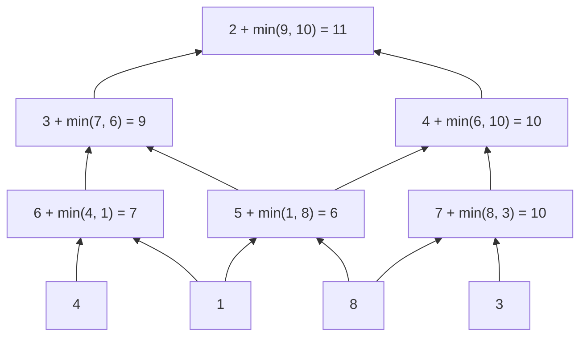

<!-- approaches: Top-down DP · Bottom-up DP in one row -->
# 120. Triangle

**Medium** · Array · Dynamic Programming · [LeetCode ↗](https://leetcode.com/problems/triangle/) · Code: [Triangle.java](Triangle.java) · Tests: [TriangleTest.java](TriangleTest.java)

## Đề bài

Đi từ đỉnh tam giác xuống đáy, từ ô `(i, j)` chỉ được xuống `(i+1, j)` hoặc `(i+1, j+1)`. Tìm tổng nhỏ nhất. Follow-up: bộ nhớ `O(n)`.

```
     2
    3 4
   6 5 7        -> 11   (2 + 3 + 5 + 1)
  4 1 8 3
```

## Ý tưởng

> Đi **từ dưới lên** thì đơn giản hơn: mỗi ô chỉ cần chọn con rẻ hơn trong **hai ô ngay dưới**, không có trường hợp biên, và đáp án tự gom về **đỉnh**.



## Cách 1 — Từ trên xuống `O(n)` bộ nhớ

`best[j]` = đường rẻ nhất tới ô `j` của hàng hiện tại. Phải xử lý riêng hai mép và đi **phải sang trái** để không ghi đè dữ liệu hàng trên; cuối cùng lấy min cả hàng đáy.

## Cách 2 — Từ dưới lên `O(n)` bộ nhớ ⭐

Mảng `dp` dài `n + 1` (khởi tạo 0) — ô thừa ở cuối giúp hàng đáy không cần xử lý riêng. Đi `j` từ trái sang: `dp[j]` và `dp[j+1]` vẫn là giá trị của hàng **dưới**.

## Bài liên quan

64 Minimum Path Sum · 931 Minimum Falling Path Sum · 118 Pascal's Triangle.
