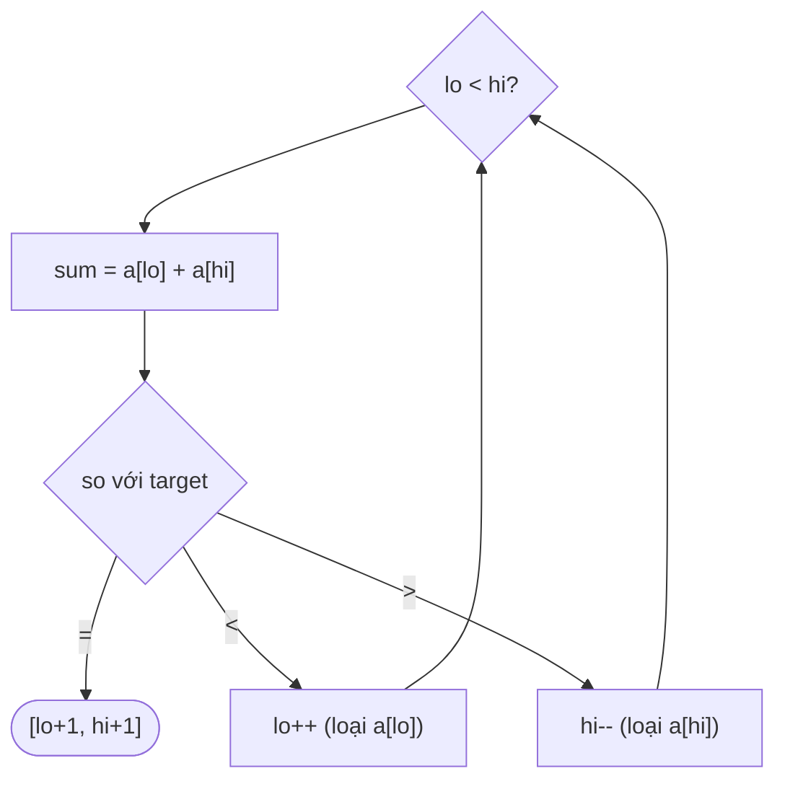

<!-- approaches: Binary search for the partner · Two pointers -->
# 167. Two Sum II - Input Array Is Sorted

**Medium** · Array · Two Pointers · Binary Search · [LeetCode ↗](https://leetcode.com/problems/two-sum-ii-input-array-is-sorted/) · Code: [TwoSumIIInputArrayIsSorted.java](TwoSumIIInputArrayIsSorted.java) · Tests: [TwoSumIIInputArrayIsSortedTest.java](TwoSumIIInputArrayIsSortedTest.java)

## Đề bài

Mảng **đã sắp xếp tăng**. Tìm hai số có tổng bằng `target`, trả về vị trí (đánh số từ **1**). Chỉ dùng bộ nhớ `O(1)`.

```
[2,7,11,15], target = 9 -> [1,2]
```

## Ý tưởng

> Hai con trỏ ở **hai đầu**. Tổng nhỏ quá → cần số lớn hơn → tăng `lo`. Tổng lớn quá → giảm `hi`.

**Vì sao không bỏ sót?** Khi `a[lo] + a[hi] < target`, thì `a[lo]` cộng với **bất kỳ** số nào còn lại (đều `≤ a[hi]`) cũng nhỏ hơn `target` → `a[lo]` chắc chắn không thuộc đáp án, loại được. Tương tự với `a[hi]` khi tổng lớn quá.



`[2, 7, 11, 15]`, target 18:

| lo | hi | sum | |
|---|---|---|---|
| 2 | 15 | 17 | < 18 → lo++ |
| 7 | 15 | 22 | > 18 → hi-- |
| 7 | 11 | **18** | → [2, 3] |

## Cách 1 — Tìm kiếm nhị phân phần bù `O(n log n)`

## Cách 2 — Hai con trỏ `O(n) · O(1)` ⭐

## So với bài 1 Two Sum

| | 1 Two Sum | 167 (bài này) |
|---|---|---|
| Mảng | không sắp xếp | đã sắp xếp |
| Cách tốt nhất | HashMap, O(n) bộ nhớ | hai con trỏ, O(1) bộ nhớ |

## Bài liên quan

1 Two Sum · 15 3Sum · 653 Two Sum IV - Input is a BST · 11 Container With Most Water.
