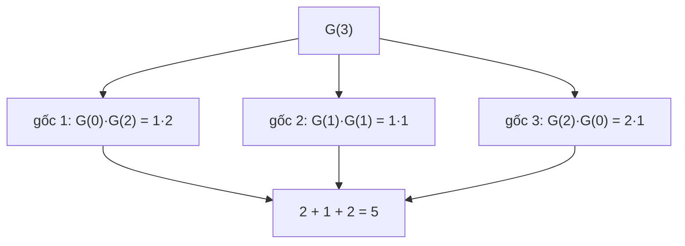

<!-- approaches: Recursion with memo · DP over tree sizes · Catalan formula -->
# 96. Unique Binary Search Trees

**Medium** · Math · Dynamic Programming · Tree · Binary Search Tree · [LeetCode ↗](https://leetcode.com/problems/unique-binary-search-trees/) · Code: [UniqueBinarySearchTrees.java](UniqueBinarySearchTrees.java) · Tests: [UniqueBinarySearchTreesTest.java](UniqueBinarySearchTreesTest.java)

## Đề bài

Có bao nhiêu **BST khác nhau về hình dạng** chứa đúng các giá trị `1 … n`?

```
n = 3 -> 5

 1        1          2         3      3
  \        \        / \       /      /
   3        2      1   3     2      1
  /          \              /        \
 2            3            1          2
```

## Ý tưởng

> Chọn **gốc** là `i`. Do tính chất BST, các giá trị `1 … i−1` **bắt buộc** nằm bên trái, `i+1 … n` nằm bên phải. Số cây chỉ phụ thuộc vào **số lượng** giá trị mỗi bên, không phụ thuộc giá trị cụ thể:
> `G(n) = Σ G(i − 1) · G(n − i)` với `i = 1 … n`.



| n | 0 | 1 | 2 | 3 | 4 | 5 |
|---|---|---|---|---|---|---|
| G(n) | 1 | 1 | 2 | 5 | 14 | 42 |

## Cách 1 — Đệ quy có nhớ

## Cách 2 — DP theo kích thước `O(n²)` ⭐

`G(0) = 1` (cây rỗng là **một** cách) — rất quan trọng, nếu đặt 0 thì mọi tích đều bằng 0.

## Cách 3 — Số Catalan `O(n)`

`G(n)` chính là **số Catalan** thứ `n`: `Cₙ₊₁ = Cₙ · 2(2n + 1) / (n + 2)`. Cùng dãy số với 22 Generate Parentheses — cả hai đều đếm cấu trúc "chia đôi đệ quy".

## Bài liên quan

95 Unique Binary Search Trees II (liệt kê các cây) · 22 Generate Parentheses · 1130 Minimum Cost Tree From Leaf Values.
