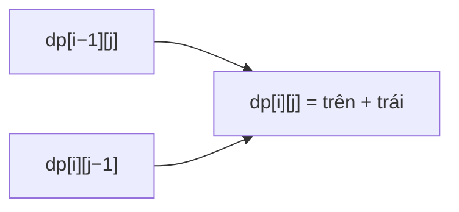

<!-- approaches: Memoized recursion · 1D DP · Combinatorics -->
# 62. Unique Paths

**Medium** · Math · Dynamic Programming · Combinatorics · [LeetCode ↗](https://leetcode.com/problems/unique-paths/) · Code: [UniquePaths.java](UniquePaths.java) · Tests: [UniquePathsTest.java](UniquePathsTest.java)

## Đề bài

Robot ở góc trên trái lưới `m × n`, chỉ đi **phải** hoặc **xuống**. Có bao nhiêu đường tới góc dưới phải?

```
m = 3, n = 7 -> 28
```

## Ý tưởng

> Số đường tới ô `(i, j)` = số đường tới ô **trên** + số đường tới ô **trái**. Hàng đầu và cột đầu chỉ có 1 đường.

| | | | | | | | |
|---|---|---|---|---|---|---|---|
| 1 | 1 | 1 | 1 | 1 | 1 | 1 |
| 1 | 2 | 3 | 4 | 5 | 6 | 7 |
| 1 | 3 | 6 | 10 | 15 | 21 | **28** |

(Chính là tam giác Pascal xoay nghiêng.)



## Cách 1 — Đệ quy có nhớ

## Cách 2 — DP một hàng `O(m·n) · O(n)` ⭐

`dp[j] += dp[j − 1]`: trước khi cộng, `dp[j]` là giá trị hàng trên.

## Cách 3 — Tổ hợp `O(min(m, n))`

Mọi đường đi gồm đúng `m − 1` bước xuống và `n − 1` bước phải, chỉ khác **thứ tự**. Số cách chọn vị trí các bước xuống trong `m + n − 2` bước: `C(m + n − 2, m − 1)`.
Tính tích dần, nhân trước chia sau bằng `long` — mỗi bước đều là số nguyên.

## Bài liên quan

63 Unique Paths II (có vật cản — phải dùng DP) · 64 Minimum Path Sum · 118 Pascal's Triangle · 980 Unique Paths III (Hard, backtracking).
