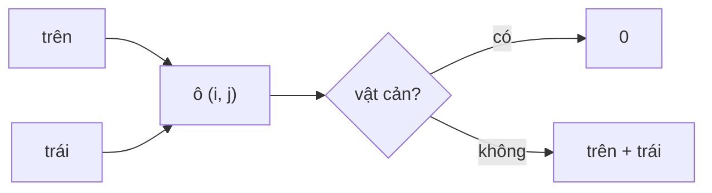

<!-- approaches: DP with obstacles, one row -->
# 63. Unique Paths II

**Medium** · Array · Dynamic Programming · Matrix · [LeetCode ↗](https://leetcode.com/problems/unique-paths-ii/) · Code: [UniquePathsII.java](UniquePathsII.java) · Tests: [UniquePathsIITest.java](UniquePathsIITest.java)

## Đề bài

Robot đi từ góc trên trái tới góc dưới phải, chỉ được đi **phải** hoặc **xuống**. Ô `1` là vật cản. Có bao nhiêu đường?

```
0 0 0
0 1 0     -> 2
0 0 0
```

## Ý tưởng

> Như bài 62: số đường tới một ô = **từ trên xuống + từ trái sang**. Thêm một luật: ô vật cản có **0 đường**.

Bảng số đường của ví dụ:

| | | |
|---|---|---|
| 1 | 1 | 1 |
| 1 | **0** | 1 |
| 1 | 1 | **2** |



## Lời giải — DP một hàng `O(m·n) · O(n)` ⭐

`ways[j]` trước khi cập nhật là giá trị **hàng trên**; cộng `ways[j−1]` (đã cập nhật) là **bên trái**. Vật cản ở ô xuất phát hoặc ô đích → tự động ra 0.

## Bài liên quan

62 Unique Paths · 64 Minimum Path Sum · 980 Unique Paths III · 2435 Paths in Matrix Whose Sum Is Divisible by K.
