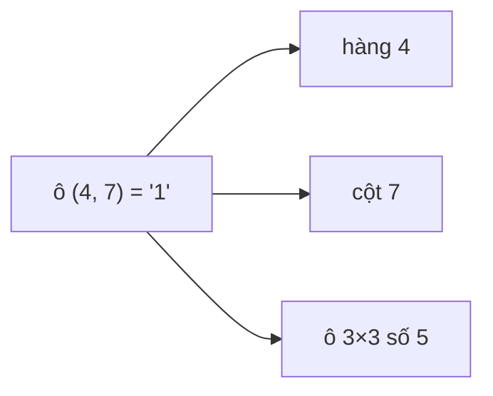

<!-- approaches: Three passes · One pass with 27 sets · One pass with bitmasks -->
# 36. Valid Sudoku

**Medium** · Array · Hash Table · Matrix · [LeetCode ↗](https://leetcode.com/problems/valid-sudoku/) · Code: [ValidSudoku.java](ValidSudoku.java) · Tests: [ValidSudokuTest.java](ValidSudokuTest.java)

## Đề bài

Kiểm tra bảng Sudoku 9×9 (đang điền dở) có **hợp lệ** không: mỗi hàng, mỗi cột, mỗi ô 3×3 không có chữ số nào lặp lại. Không cần kiểm tra giải được hay không.

## Ý tưởng

> Mỗi chữ số đã điền thuộc đúng **ba nhóm**: hàng `i`, cột `j`, và ô 3×3 số `(i/3)·3 + j/3`. Chỉ cần một lượt duyệt, kiểm tra chữ số đã có trong nhóm nào chưa.

```
 ô 3×3 đánh số:      0 | 1 | 2
                     ---------
                     3 | 4 | 5      box = (i / 3) * 3 + j / 3
                     ---------
                     6 | 7 | 8
```



## Cách 1 — Một HashSet với khoá dạng chuỗi

`"5 in row 0"`, `"5 in col 3"`, `"5 in box 0-1"` — dễ đọc, dễ nói khi phỏng vấn.

## Cách 2 — Mặt nạ bit `O(1)` ⭐

27 số nguyên (9 hàng, 9 cột, 9 ô); bit `d` bật nghĩa là chữ số `d + 1` đã xuất hiện. Kiểm tra bằng `&`, thêm bằng `|=`. Nhanh và không cấp phát.

## Bài liên quan

37 Sudoku Solver (Hard, backtracking dùng đúng ba mặt nạ này) · 1222 Queens That Can Attack the King · 51 N-Queens.
