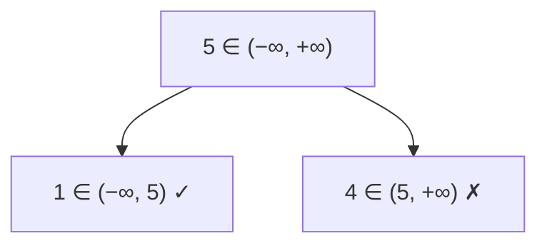

<!-- approaches: DFS with (low, high) bounds · Inorder must be strictly increasing -->
# 98. Validate Binary Search Tree

**Medium** · Tree · Depth-First Search · Binary Search Tree · Binary Tree · [LeetCode ↗](https://leetcode.com/problems/validate-binary-search-tree/) · Code: [ValidateBinarySearchTree.java](ValidateBinarySearchTree.java) · Tests: [ValidateBinarySearchTreeTest.java](ValidateBinarySearchTreeTest.java)

## Đề bài

Cây có phải **BST hợp lệ** không: mọi node trong cây con trái **nhỏ hơn**, mọi node trong cây con phải **lớn hơn** (nghiêm ngặt)?

```
    5
   / \
  1   4        -> false: 3 nằm trong cây con phải của 5 nhưng nhỏ hơn 5
     / \
    3   6
```

## Ý tưởng

> **Bẫy kinh điển:** chỉ so node với **con trực tiếp** là chưa đủ — ví dụ trên `4 < 6` và `3 < 4` đều đúng cục bộ.
> Mỗi node phải nằm trong một **khoảng** `(low, high)` do **tổ tiên** quy định. Đi sang trái thì cận trên thành giá trị node; sang phải thì cận dưới thành giá trị node.



## Cách 1 — DFS với khoảng `(low, high)` `O(n)` ⭐

Dùng `long` cho cận để cây có node `Integer.MIN_VALUE` / `MAX_VALUE` vẫn đúng.

## Cách 2 — Duyệt inorder

Inorder của BST là dãy **tăng nghiêm ngặt**. Duyệt bằng stack, so mỗi giá trị với giá trị liền trước. Giá trị trùng (`[2,2,2]`) → không hợp lệ.

## Bài liên quan

99 Recover Binary Search Tree · 230 Kth Smallest Element in a BST · 1373 Maximum Sum BST in Binary Tree · 501 Find Mode in BST.
