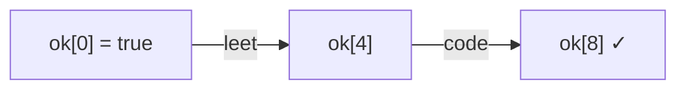

<!-- approaches: DP over prefixes · BFS over start indices -->
# 139. Word Break

**Medium** · Array · Hash Table · String · Dynamic Programming · [LeetCode ↗](https://leetcode.com/problems/word-break/) · Code: [WordBreak.java](WordBreak.java) · Tests: [WordBreakTest.java](WordBreakTest.java)

## Đề bài

Chuỗi `s` có tách được thành dãy các từ trong từ điển không (một từ dùng nhiều lần được)?

```
"leetcode", [leet, code]                     -> true
"catsandog", [cats, dog, sand, and, cat]     -> false
```

## Ý tưởng

> `ok[i]` = **tiền tố** `s[0..i)` tách được. `ok[i] = true` nếu tồn tại `j < i` với `ok[j] = true` **và** `s[j..i)` là một từ.
> Thử tham lam (luôn cắt từ dài nhất / ngắn nhất) là sai — phải xét **mọi** điểm cắt, nhưng DP nhớ lại kết quả nên không bị bùng nổ.

`"leetcode"`:

| i | 0 | 1 | 2 | 3 | 4 | 5 | 6 | 7 | 8 |
|---|---|---|---|---|---|---|---|---|---|
| ok | ✓ | | | | ✓ (leet) | | | | ✓ (code) |



## Cách 1 — DP trên tiền tố `O(n·L)` ⭐

Chỉ thử `j` cách `i` tối đa độ dài từ dài nhất → nhanh hơn nhiều so với `O(n²)`.

## Cách 2 — BFS trên vị trí bắt đầu

Mỗi vị trí là một node; có cạnh `j → i` khi `s[j..i)` là từ. Hỏi: đi từ 0 tới `n` được không? Đánh dấu đã thăm để không lặp lại — cùng độ phức tạp với DP.

## Bẫy & lưu ý

Đệ quy thuần không nhớ bùng nổ hàm mũ với `"aaaa…ab"` và từ điển `[a, aa, aaa, …]` (test có ca này).

## Bài liên quan

140 Word Break II (liệt kê mọi cách tách — Hard) · 472 Concatenated Words · 322 Coin Change.
