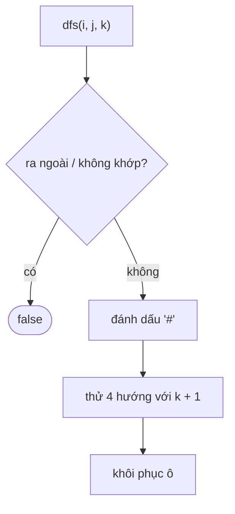

<!-- approaches: DFS backtracking marking the board in place -->
# 79. Word Search

**Medium** · Array · String · Backtracking · Depth-First Search · [LeetCode ↗](https://leetcode.com/problems/word-search/) · Code: [WordSearch.java](WordSearch.java) · Tests: [WordSearchTest.java](WordSearchTest.java)

## Đề bài

Từ `word` có trong lưới không? Các chữ phải **kề nhau** (trên/dưới/trái/phải), mỗi ô dùng **một lần**.

```
A B C E
S F C S      "ABCCED" -> true    "SEE" -> true    "ABCB" -> false (B dùng lại)
A D E E
```

## Ý tưởng — quay lui

> Thử **mọi ô** làm điểm bắt đầu. Từ ô đang đứng, nếu khớp chữ thứ `k` thì đi tiếp sang 4 ô kề với chữ `k + 1`.
> **Đánh dấu** ô đang nằm trên đường đi (ghi đè `'#'`) để không dùng lại, và **khôi phục** khi quay lui.

```
"ABCCED":
A → B → C
        ↓
    D ← E ← C (đi xuống rồi sang trái)
```



## Lời giải — DFS quay lui `O(m·n·3ᴸ)` ⭐

`3ᴸ` vì từ bước thứ hai trở đi chỉ còn 3 hướng (không quay lại ô vừa đi).

**Tối ưu thêm (khi phỏng vấn hỏi):**
- Đếm chữ cái: lưới không đủ chữ cho `word` → trả `false` ngay.
- Nếu chữ đầu của `word` hiếm hơn chữ cuối → đảo ngược `word` để cắt nhánh sớm hơn.

## Bài liên quan

212 Word Search II (nhiều từ — Trie) · 200 Number of Islands · 980 Unique Paths III.
