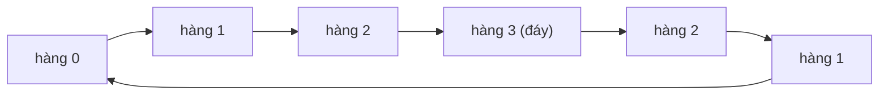

<!-- approaches: Row buckets · Direct index formula per row -->
# 6. Zigzag Conversion

**Medium** · String · [LeetCode ↗](https://leetcode.com/problems/zigzag-conversion/) · Code: [ZigzagConversion.java](ZigzagConversion.java) · Tests: [ZigzagConversionTest.java](ZigzagConversionTest.java)

## Đề bài

Viết chuỗi theo hình **zigzag** trên `numRows` hàng, rồi đọc từng hàng.

```
numRows = 4:   P     I     N
               A   L S   I G       -> "PINALSIGYAHRPI"
               Y A   H R
               P     I
```

## Ý tưởng

> Không cần dựng lưới 2D. Chỉ cần biết **mỗi ký tự rơi vào hàng nào**: hàng chạy `0, 1, …, n−1, n−2, …, 1, 0, 1, …` — đi xuống, chạm đáy thì đi lên, chạm đỉnh thì đi xuống.



## Cách 1 — Gom theo hàng ⭐

Mỗi hàng một `StringBuilder`; biến `step = ±1` đổi chiều khi chạm hàng đầu/cuối.

## Cách 2 — Công thức chỉ số

Mẫu lặp lại sau mỗi **chu kỳ** `2·numRows − 2` ký tự. Hàng `r` lấy các vị trí `k·chu kỳ + r`; hàng **giữa** lấy thêm `k·chu kỳ + chu kỳ − r` (ký tự trên đường đi lên).

| numRows = 4, chu kỳ 6 | vị trí |
|---|---|
| hàng 0 | 0, 6, 12 |
| hàng 1 | 1, 5, 7, 11, 13 |
| hàng 2 | 2, 4, 8, 10 |
| hàng 3 | 3, 9 |

## Bẫy & lưu ý

- `numRows = 1` → chu kỳ bằng 0, vòng lặp không tiến — phải trả về ngay.

## Bài liên quan

54 Spiral Matrix · 498 Diagonal Traverse.
