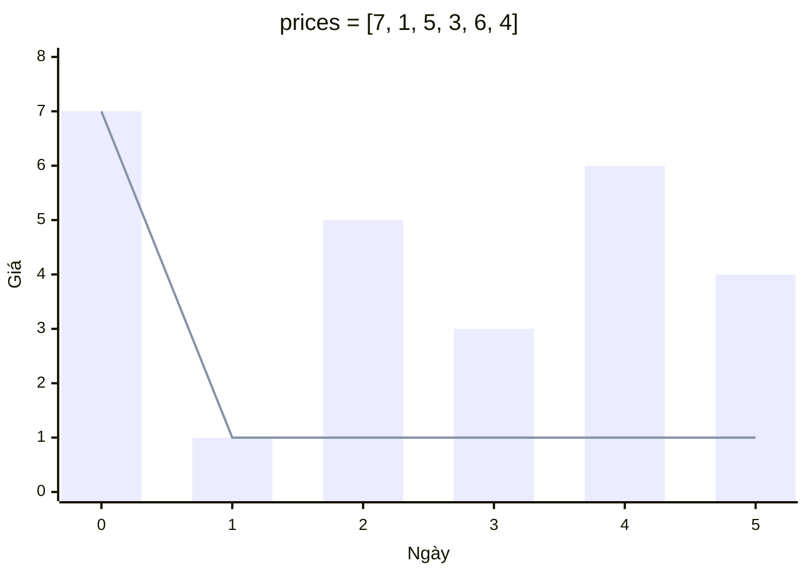
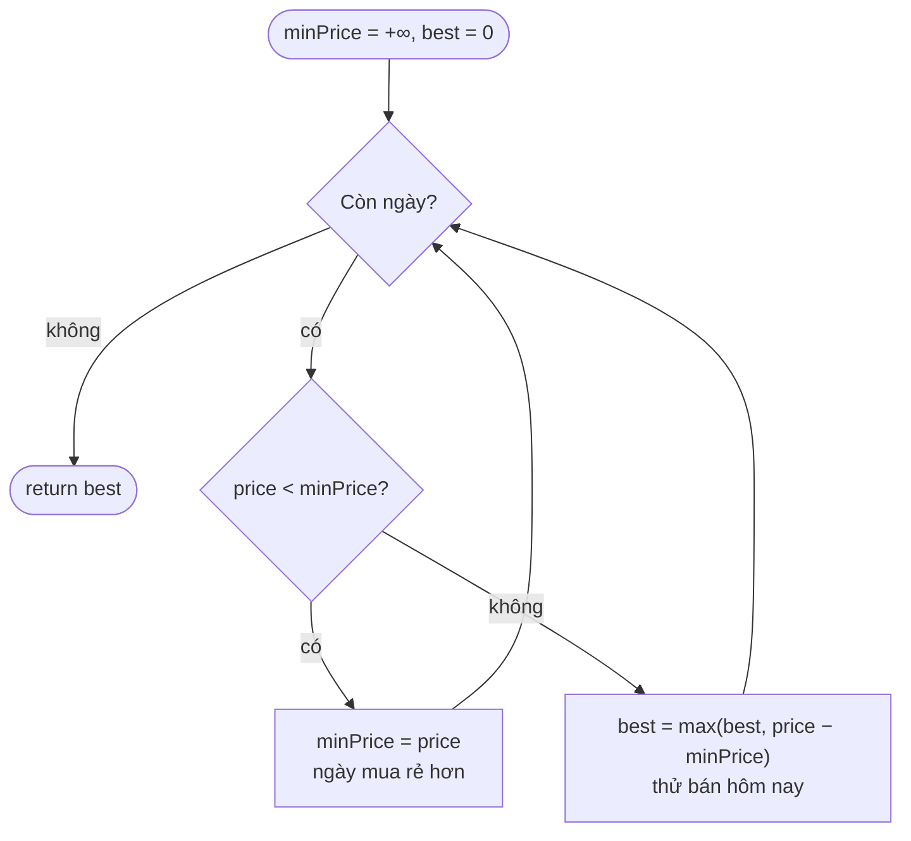
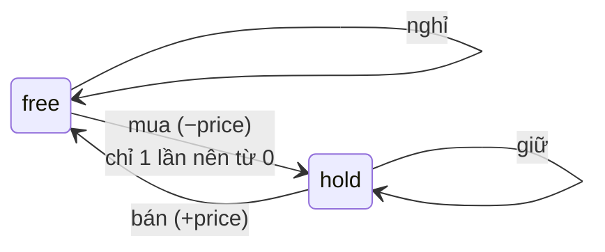

# 121. Best Time to Buy and Sell Stock — Easy

🔗 https://leetcode.com/problems/best-time-to-buy-and-sell-stock/ · Code: [BestTimeToBuyAndSellStock.java](BestTimeToBuyAndSellStock.java)

## Đề bài

Cho mảng `prices`, `prices[i]` là giá cổ phiếu ngày `i`. Được **mua 1 lần và bán 1 lần** (bán phải sau ngày mua).
Trả về lợi nhuận lớn nhất, không có lời thì trả `0`.

```
prices = [7, 1, 5, 3, 6, 4]  ->  5   (mua ngày 1 giá 1, bán ngày 4 giá 6)
prices = [7, 6, 4, 3, 1]     ->  0   (giá chỉ giảm)
```



*Cột = giá từng ngày, đường = giá thấp nhất tính tới ngày đó. Lãi lớn nhất = khoảng cách lớn nhất giữa cột và đường **ở phía sau** đáy (ngày 4: 6 − 1 = 5).*

## Ý tưởng cốt lõi

> Nếu bán vào ngày `i`, cách mua tốt nhất là mua ở **giá thấp nhất trước ngày `i`**.

Vậy chỉ cần nhớ `minPrice` đã gặp, và mỗi ngày hỏi: "bán hôm nay thì lãi bao nhiêu?".

## Các cách giải

| # | Cách | Thời gian | Bộ nhớ | Ghi chú |
|---|---|---|---|---|
| 1 | Vét cạn mọi cặp (mua, bán) | O(n²) | O(1) | Đúng nhưng TLE với n = 10⁵; dùng làm "chuẩn" để test |
| 2 | Một lượt, giữ `minPrice` | **O(n)** | **O(1)** | Câu trả lời mong đợi khi phỏng vấn |
| 3 | DP trạng thái `hold` / `free` | O(n) | O(1) | Cùng kết quả, nhưng mở rộng được cho cả họ bài cổ phiếu |

### Cách 2 — một lượt



Chạy tay với `[7, 1, 5, 3, 6, 4]`:

| Ngày | price | minPrice | price − minPrice | best |
|---|---|---|---|---|
| 0 | 7 | **7** | – | 0 |
| 1 | 1 | **1** | – | 0 |
| 2 | 5 | 1 | 4 | 4 |
| 3 | 3 | 1 | 2 | 4 |
| 4 | 6 | 1 | 5 | **5** |
| 5 | 4 | 1 | 3 | 5 |

### Cách 3 — DP hai trạng thái

Sau mỗi ngày ta ở một trong hai trạng thái: đang **giữ** 1 cổ phiếu (`hold`) hoặc **không giữ** (`free`). Giá trị là tiền mặt tốt nhất đạt được.



```
hold = max(hold, -price)          // giữ tiếp, hoặc mua hôm nay
free = max(free, hold + price)    // ở ngoài, hoặc bán hôm nay
```

Vì sao đáng học: chỉ cần đổi phép chuyển là giải được cả họ bài:

| Bài | Thay đổi |
|---|---|
| 122 — mua bán không giới hạn | `hold = max(hold, free - price)` (mua từ lợi nhuận đang có) |
| 309 — có cooldown 1 ngày | thêm trạng thái `cooldown` |
| 714 — có phí giao dịch | `free = max(free, hold + price - fee)` |
| 123 / 188 — tối đa k giao dịch | mảng `hold[k]`, `free[k]` |

## Bẫy hay gặp

- Lấy `max(prices) − min(prices)` là **sai**: ngày min có thể nằm sau ngày max (`[2, 9, 1, 3]` → đáp án 7, không phải 8).
- Không cho lãi âm: `best` bắt đầu từ `0`.
- Mảng 1 phần tử → `0`.
- Khởi tạo `hold = Integer.MIN_VALUE` an toàn vì ngày đầu luôn cập nhật thành `-price` trước khi cộng.

## Câu hỏi phỏng vấn hay hỏi thêm

1. *Trả về cả ngày mua và ngày bán?* → lưu chỉ số `minIndex` khi cập nhật `minPrice`, và cặp `(minIndex, i)` khi cập nhật `best`.
2. *Dữ liệu là luồng (stream) giá?* → cách 2 đã là online, O(1) bộ nhớ.
3. *Liên hệ với bài nào?* → đây là **Kadane** trên mảng chênh lệch `prices[i] − prices[i−1]` (bài 53 Maximum Subarray).
