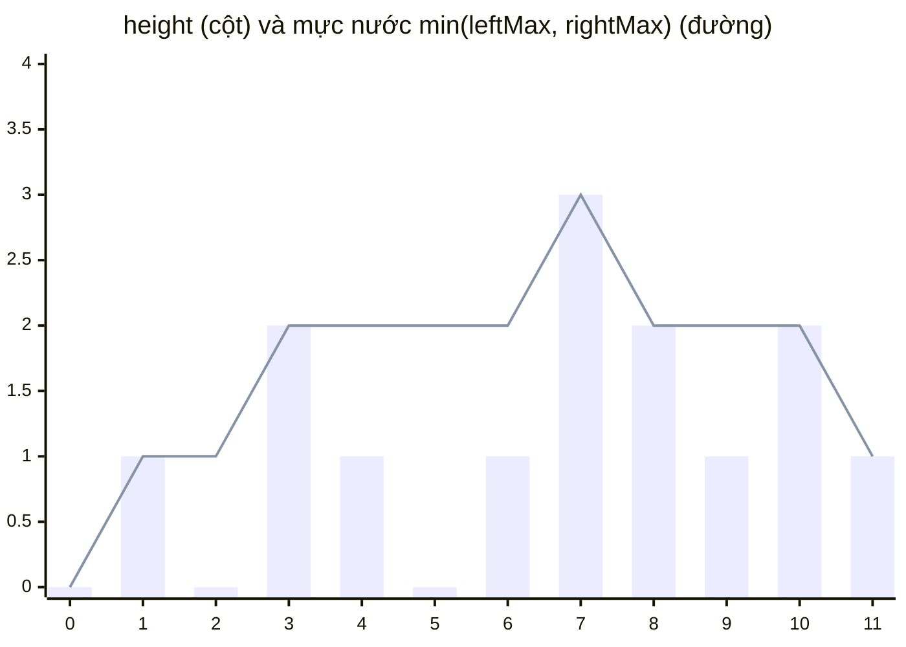
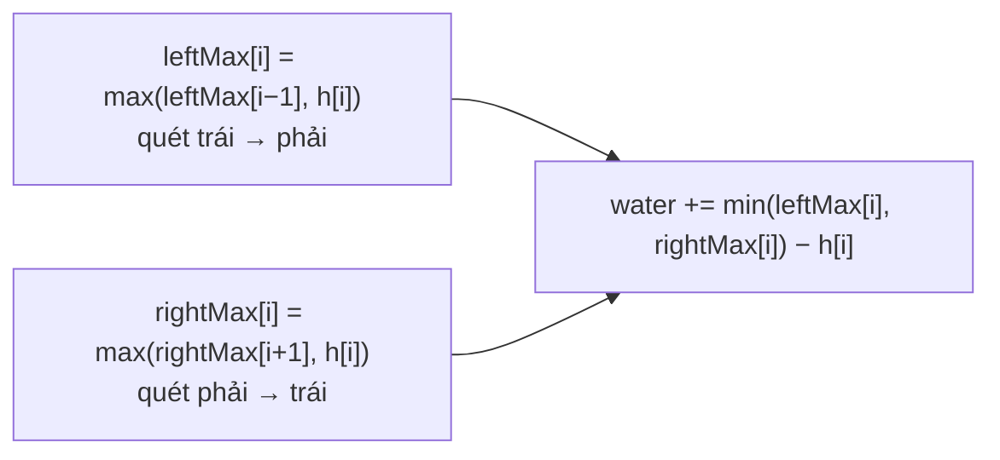
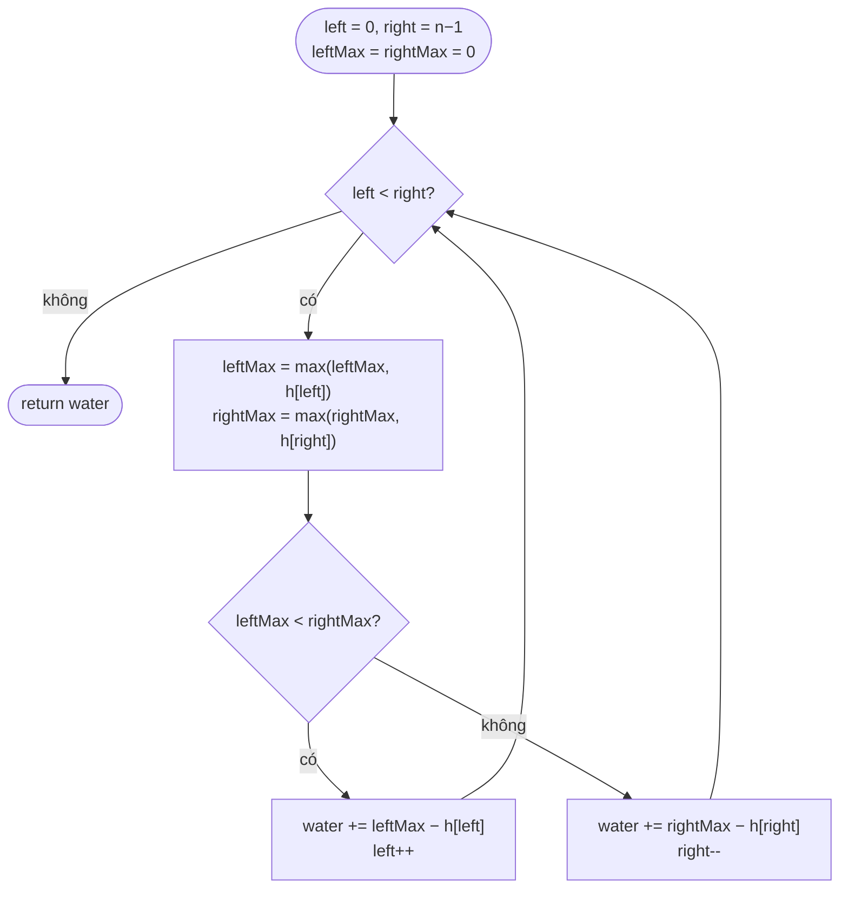
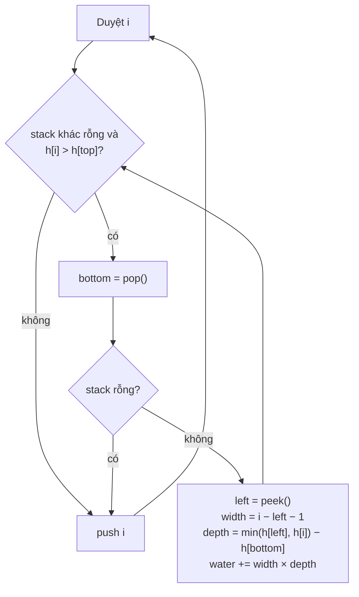

# 42. Trapping Rain Water — Hard

🔗 https://leetcode.com/problems/trapping-rain-water/ · Code: [TrappingRainWater.java](TrappingRainWater.java)

## Đề bài

Mảng `height` mô tả các cột rộng 1. Sau cơn mưa, nước đọng lại được bao nhiêu?

```
height = [0,1,0,2,1,0,1,3,2,1,2,1]  ->  6
height = [4,2,0,3,2,5]              ->  9
```



*Nước tại mỗi ô = khoảng cách giữa đường và cột: 0+0+1+0+1+2+1+0+0+1+0+0 = **6**.*

## Ý tưởng cốt lõi

> Nước trên cột `i` = `min(cao nhất bên trái, cao nhất bên phải) − height[i]` (tính cả chính nó nên không bao giờ âm).

Nước bị giới hạn bởi **bức tường thấp hơn** trong hai bức tường cao nhất hai bên — như cái thùng bị giới hạn bởi tấm ván ngắn nhất.

## Các cách giải

| # | Cách | Thời gian | Bộ nhớ | Cách nghĩ |
|---|---|---|---|---|
| 1 | Vét cạn: với mỗi cột quét hai bên tìm max | O(n²) | O(1) | Áp thẳng công thức |
| 2 | Tính trước `leftMax[]`, `rightMax[]` | O(n) | O(n) | DP — bỏ việc quét lặp |
| 3 | Stack đơn điệu | O(n) | O(n) | Đổ nước **theo từng lớp ngang** |
| 4 | Hai con trỏ | **O(n)** | **O(1)** | Bỏ mảng phụ — **câu trả lời mong đợi** |

### Cách 2 — tính trước hai mảng



| i | 0 | 1 | 2 | 3 | 4 | 5 | 6 | 7 | 8 | 9 | 10 | 11 |
|---|---|---|---|---|---|---|---|---|---|---|---|---|
| height | 0 | 1 | 0 | 2 | 1 | 0 | 1 | 3 | 2 | 1 | 2 | 1 |
| leftMax | 0 | 1 | 1 | 2 | 2 | 2 | 2 | 3 | 3 | 3 | 3 | 3 |
| rightMax | 3 | 3 | 3 | 3 | 3 | 3 | 3 | 3 | 2 | 2 | 2 | 1 |
| nước | 0 | 0 | **1** | 0 | **1** | **2** | **1** | 0 | 0 | **1** | 0 | 0 |

### Cách 4 — hai con trỏ (O(1) bộ nhớ)

Nhận xét then chốt: nếu `leftMax < rightMax` thì ở bên phải **chắc chắn** có bức tường ≥ `rightMax` > `leftMax`, nên nước tại `left` chỉ phụ thuộc `leftMax` — chốt được ngay, không cần biết max thật sự bên phải.



Luôn **di chuyển phía có tường thấp hơn** — phía đó là phía "bị giới hạn", nên tính được chắc chắn.

### Cách 3 — stack đơn điệu (đổ nước theo lớp)

Stack giữ chỉ số các cột **giảm dần**. Gặp cột cao hơn đỉnh stack → vừa đóng một "lòng chảo": đáy là cột vừa pop, hai thành là đỉnh stack mới và cột hiện tại.



Khác với cách 2 và 4 (tính **theo cột dọc**), cách này cộng **theo lớp ngang** — hữu ích cho các bài kiểu "khoảng giữa hai cột cao hơn" (Largest Rectangle in Histogram, Daily Temperatures).

## Bẫy hay gặp

- Cách 4: so sánh `leftMax < rightMax` (đã cập nhật) chứ không phải `height[left] < height[right]` — cả hai đều đúng nếu cập nhật max trước, nhưng trộn lẫn hai kiểu dễ sai.
- Cách 3: pop xong mà stack rỗng thì **không có thành trái** — nước tràn, bỏ qua.
- Mảng < 3 cột không giữ được nước; mảng chỉ tăng / chỉ giảm cũng vậy.
- Kết quả tối đa ~ 2·10⁴ × 10⁵ = 2·10⁹ — sát giới hạn `int` (2.147·10⁹), vẫn vừa; nếu ràng buộc lớn hơn nên dùng `long`.

## Câu hỏi phỏng vấn hay hỏi thêm

1. *Bản 2D (bài 407 — Trapping Rain Water II)?* → min-heap các ô biên, BFS từ bức tường thấp nhất vào trong (ý tưởng "di chuyển phía thấp hơn" của cách 4, mở rộng ra 2D).
2. *Container With Most Water (bài 11) khác gì?* → chỉ chọn **2** cột làm thành, bỏ qua các cột ở giữa; cũng hai con trỏ, di chuyển phía thấp hơn.
3. *Dữ liệu dạng stream từ trái sang phải?* → không chốt được nước cho tới khi biết bên phải; cách 3 (stack) xử lý online được, cộng nước ngay khi lòng chảo đóng lại.
